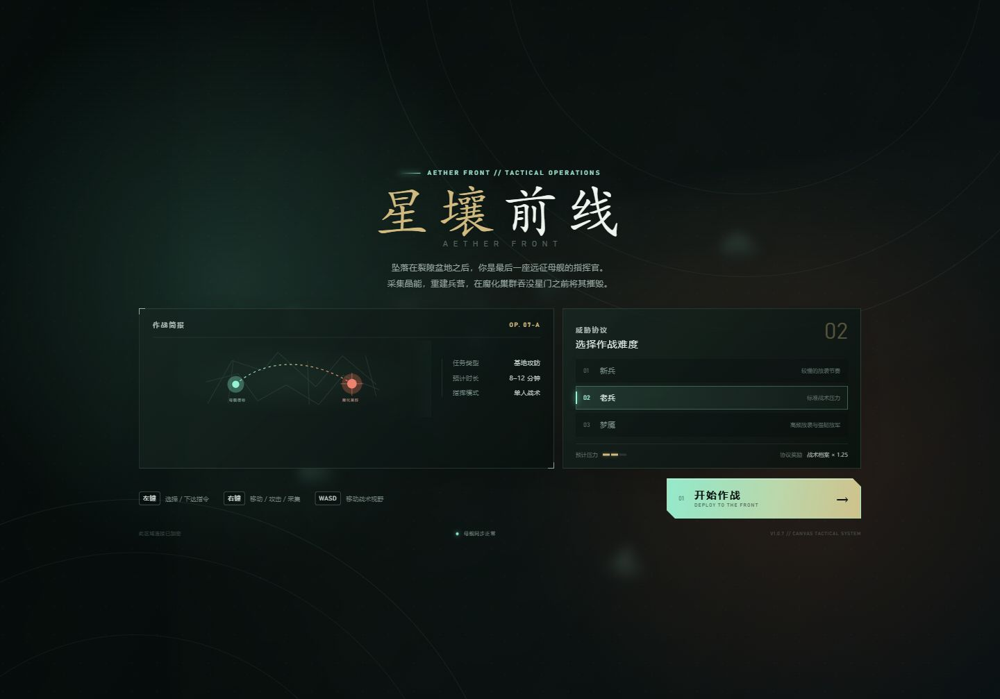
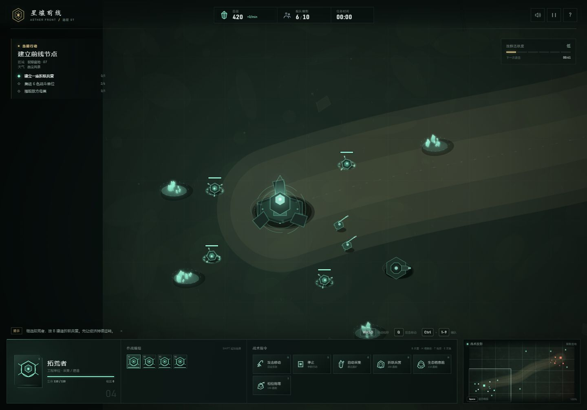

<p align="center">
  
</p>

<h1 align="center">Aether Front</h1>
<h3 align="center">星壤前线 · A browser-native real-time strategy game</h3>

<p align="center">
  Gather aether. Build a strike force. Destroy the corruption core before it consumes the frontier.
</p>

<p align="center">
  <a href="https://zhuanght-1201.github.io/aether-front/"><strong>▶ Play in browser</strong></a>
  &nbsp;·&nbsp;
  <a href="https://github.com/ZhuangHT-1201/aether-front/issues">Report a bug</a>
  &nbsp;·&nbsp;
  <a href="https://github.com/ZhuangHT-1201/aether-front/issues/new">Suggest a feature</a>
</p>

<p align="center">
  
  
  
  
</p>

---

**Aether Front** is a compact, single-player RTS built for the browser without frameworks, external art packs, or a build step. It combines classic real-time strategy fundamentals with a bespoke sci-fi presentation: crystal harvesting, base construction, production queues, formations, attack-move orders, particle-driven battles, and escalating enemy waves.

> 中文简介：**《星壤前线》**是一款无需安装依赖的浏览器即时战略小游戏。采集晶能、扩建兵营、训练部队，在腐化潮吞没星门之前摧毁敌方母巢。

## Gameplay

<p align="center">
  
</p>

### What is in the game

- **Economy** — Workers automatically harvest nearby aether crystals and return them to the expedition mothership.
- **Base building** — Deploy barracks, habitat domes, and automatic phase turrets through a grid-aware placement preview.
- **Army composition** — Train ranged Rangers and armored Guards, then combine them with worker support to break the corruption perimeter.
- **Real-time combat** — Projectiles, melee strikes, health states, auto-acquisition, attack-move, hold position, and unit formations.
- **Enemy pressure** — Three difficulty protocols with escalating attack waves and a defended enemy stronghold.
- **Tactical interface** — Drag selection, control groups, contextual command cards, production queues, objectives, and a real-time minimap.
- **Presentation** — Procedural terrain, layered faction architecture, particle effects, responsive HUD, and synthesized Web Audio sound.

## Play

The project is designed to run directly in a modern desktop browser.

### Option 1 — Play locally

```bash
git clone https://github.com/ZhuangHT-1201/aether-front.git
cd aether-front
npm start
```

Open [http://127.0.0.1:8080](http://127.0.0.1:8080).

You can also open `index.html` directly. A local server is recommended for consistent browser behavior.

### Option 2 — Play online

The latest build is deployed automatically to GitHub Pages:

**https://zhuanght-1201.github.io/aether-front/**

## Controls

| Input | Action |
| --- | --- |
| Left-click / drag | Select a unit or drag-select an army |
| Right-click | Move, attack, harvest, or set a rally point |
| `WASD` / Arrow keys | Pan the battlefield |
| Mouse wheel | Zoom |
| `Q` | Attack-move |
| `S` | Stop the current order |
| `Shift` + left-click | Add to or remove from the selection |
| `Ctrl` + `1-9` | Save a control group |
| `1-9` | Recall a control group |
| `B` / `H` / `T` | Build barracks / habitat / turret while a worker is selected |
| `R` / `G` / `Z` | Train Ranger / Guard / Worker from the relevant building |
| `Space` | Return to the mothership |
| `P` | Pause |
| `M` | Mute |
| `F1` | Show the in-game manual |
| `Esc` | Cancel placement or close an overlay |

## Objectives

1. Build a jump barracks.
2. Field at least six combat units.
3. Destroy the corruption core in the northern stronghold.

The corruption sends increasingly dangerous attack waves toward your mothership. Expand your economy and population early, then push out before the battlefield becomes overwhelmed.

## Technical Notes

- **No runtime dependencies** and **no build step**
- Custom Canvas 2D renderer with depth sorting and screen-space feedback
- Procedural terrain and faction architecture drawn entirely in code
- Web Audio synthesizer for shots, construction, alerts, and UI feedback
- CSS-only HUD with responsive layouts for desktop and compact viewports
- Small zero-dependency Node static server for local play

```text
.
├── index.html                 # Game shell, HUD, briefing, and overlays
├── style.css                  # Tactical interface and responsive presentation
├── game.js                    # Simulation, rendering, AI, input, and audio
├── server.js                  # Zero-dependency local server
├── screenshots/
│   ├── hero.png
│   └── gameplay.png
└── .github/workflows/         # Validation and GitHub Pages deployment
```

## Development

Check the JavaScript syntax:

```bash
npm run check
```

There is no bundling step. Edit the source and refresh the browser.

## Roadmap

- Additional maps and biome-specific terrain
- Two-faction campaign missions
- Unit upgrades and active abilities
- Improved pathfinding around large structures
- Accessibility and gamepad control options

Suggestions and pull requests are welcome. See [CONTRIBUTING.md](CONTRIBUTING.md) for the contribution workflow.

## License

Released under the [MIT License](LICENSE).

Designed and developed by **Huiteng Zhuang** · English name: **Evan Zhuang**.
